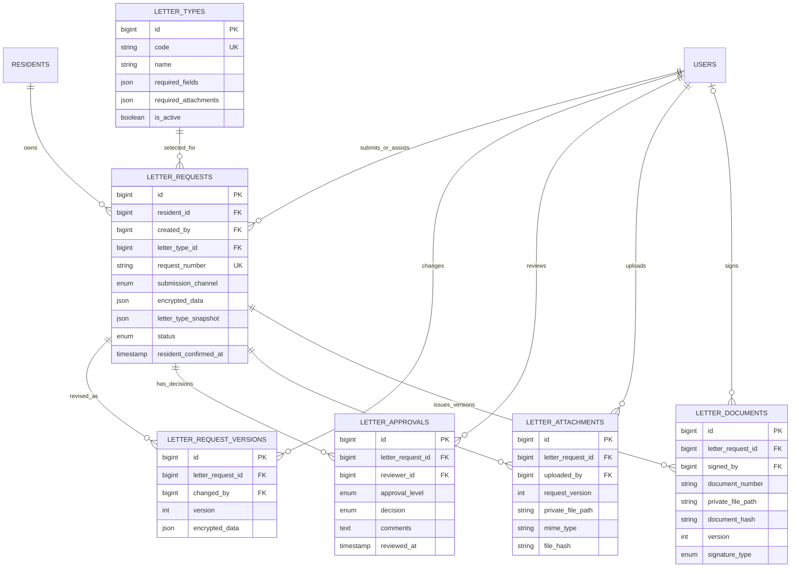
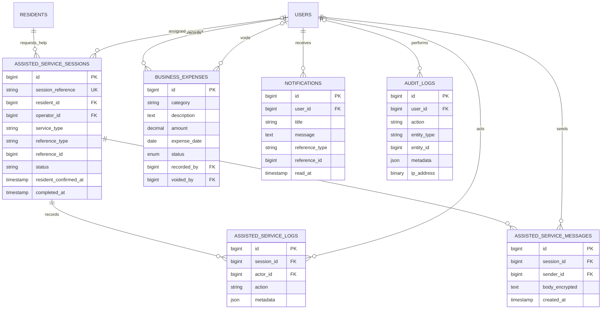

# ERD Implementasi — Integrated Village Digital Platform

Dokumen ini menggambarkan struktur yang dibentuk oleh **54 tabel pada migration Laravel saat ini**, dikelompokkan per domain agar hubungan antartabel tetap terbaca seperti diagram referensi. Kolom kunci ditampilkan di kotak entitas; kolom audit/timestamp standar yang berulang disingkat.

## Daftar gambar ERD

Gambar tersedia dalam PNG untuk dibagikan dan SVG untuk diperbesar tanpa pecah. Tabel abu-abu hanya disebut sebagai ujung relasi di diagram sumber; kolomnya tidak dirinci di sana.

- **Identitas, desa, wilayah, dan peran:** [PNG](docs/erd-images/01-identitas-wilayah-peran.png) · [SVG](docs/erd-images/01-identitas-wilayah-peran.svg)
- **Persuratan desa:** [PNG](docs/erd-images/02-persuratan.png) · [SVG](docs/erd-images/02-persuratan.svg)
- **Internet, langganan, dan Wi-Fi:** [PNG](docs/erd-images/03-internet-wifi.png) · [SVG](docs/erd-images/03-internet-wifi.svg)
- **Pasar desa, pesanan, dan pembayaran:** [PNG](docs/erd-images/04-pasar-pesanan-pembayaran.png) · [SVG](docs/erd-images/04-pasar-pesanan-pembayaran.svg)
- **Bantuan digital, operasional, dan audit:** [PNG](docs/erd-images/05-bumdes-bantuan-audit.png) · [SVG](docs/erd-images/05-bumdes-bantuan-audit.svg)
- **Infrastruktur Laravel:** [PNG](docs/erd-images/06-infrastruktur-laravel.png) · [SVG](docs/erd-images/06-infrastruktur-laravel.svg)

## Sumber dan batas verifikasi

- Sumber ERD: definisi `database/migrations`, termasuk migration lanjutan sampai `2026_11_10_130000_add_marketplace_group_payments_and_split_allocations.php`.
- Upaya membaca metadata database aktif dengan `php artisan db:show` pada 12 November 2026 gagal karena koneksi database menghasilkan `SQLSTATE[HY000] [2002] Unknown error while connecting`.
- Karena itu, ini adalah ERD **migration-defined**, bukan hasil introspeksi langsung database server. Cocokkan kembali dengan `information_schema` setelah koneksi database tersedia sebelum menganggapnya sebagai snapshot database aktif.
- `ERD.md` tetap menjadi dokumen desain/logical requirements yang sudah ada; dokumen ini memisahkan ERD implementasi agar rancangan lama tidak tertimpa.

## Ikhtisar domain

| Domain | Tabel |
|---|---|
| Identitas, desa, dan akses | `users`, `roles`, `user_roles`, `villages`, `regions`, `residents`, `region_officers`, `bumdes_staff` |
| Persuratan | `letter_types`, `letter_requests`, `letter_request_versions`, `letter_approvals`, `letter_attachments`, `letter_documents` |
| Internet dan Wi-Fi | `internet_packages`, `wifi_networks`, `network_devices`, `installation_requests`, `installation_request_events`, `internet_subscriptions`, `subscription_invoices`, `service_requests`, `wifi_access_logs` |
| Pasar desa dan transaksi | `sellers`, `seller_status_events`, `seller_documents`, `product_categories`, `products`, `product_images`, `product_moderation_events`, `carts`, `cart_items`, `checkout_groups`, `orders`, `order_items`, `order_status_events`, `deliveries`, `delivery_events`, `payments`, `payment_events`, `payment_allocations` |
| Operasional BUMDes dan sistem | `assisted_service_sessions`, `assisted_service_logs`, `assisted_service_messages`, `business_expenses`, `notifications`, `audit_logs` |
| Infrastruktur Laravel | `password_reset_tokens`, `sessions`, `cache`, `cache_locks`, `jobs`, `job_batches`, `failed_jobs` |

## 1. Identitas, desa, wilayah, dan peran

```mermaid
erDiagram
    USERS ||--o{ USER_ROLES : receives
    ROLES ||--o{ USER_ROLES : assigned_as
    USERS ||--o| RESIDENTS : owns_profile
    VILLAGES ||--o{ REGIONS : contains
    REGIONS o|--o{ REGIONS : parent_rw_of_rt
    REGIONS ||--o{ RESIDENTS : resident_area
    USERS o|--o{ REGION_OFFICERS : assigned
    REGIONS o|--o{ REGION_OFFICERS : staffed_by
    USERS ||--o| BUMDES_STAFF : staff_profile

    USERS {
        bigint id PK
        string username UK
        string email UK
        string password
        string name_ciphertext
        string phone_ciphertext
        enum account_status
        timestamp email_verified_at
    }
    ROLES {
        bigint id PK
        string name UK
        string description
    }
    USER_ROLES {
        bigint id PK
        bigint user_id FK
        bigint role_id FK
        bigint assigned_by FK
        timestamp assigned_at
    }
    VILLAGES {
        bigint id PK
        string code UK
        string name
        text address
        boolean is_active
    }
    REGIONS {
        bigint id PK
        bigint village_id FK
        bigint parent_id FK
        enum region_type
        string region_code
        string name
    }
    RESIDENTS {
        bigint id PK
        bigint user_id FK_UK
        bigint region_id FK
        text full_name_ciphertext
        text phone_ciphertext
        text address_ciphertext
        text birth_date_ciphertext
        text gender_ciphertext
        timestamp region_verified_at
    }
    REGION_OFFICERS {
        bigint id PK
        bigint user_id FK
        bigint former_user_id
        bigint region_id FK
        bigint former_region_id
        bigint assigned_by FK
        boolean is_active
        timestamp ended_at
    }
    BUMDES_STAFF {
        bigint id PK
        bigint user_id FK_UK
        string department
        string position
        enum employment_status
    }
```

`RESIDENTS` tidak menyimpan NIK pada skema akhir migration: migration penghapusan NIK menghilangkan ciphertext, nonce, tag, dan blind index NIK. Data demografis yang tersisa memakai kolom ciphertext beserta nonce/tag sesuai migration enkripsi.

## 2. Persuratan desa



## 3. Internet, langganan, dan Wi-Fi

```mermaid
erDiagram
    RESIDENTS ||--o{ INSTALLATION_REQUESTS : requests
    INTERNET_PACKAGES ||--o{ INSTALLATION_REQUESTS : selected_package
    INSTALLATION_REQUESTS ||--o{ INSTALLATION_REQUEST_EVENTS : status_history
    USERS o|--o{ INSTALLATION_REQUEST_EVENTS : acts
    INSTALLATION_REQUESTS o|--o| INTERNET_SUBSCRIPTIONS : activates
    RESIDENTS ||--o{ INTERNET_SUBSCRIPTIONS : owns
    INTERNET_PACKAGES ||--o{ INTERNET_SUBSCRIPTIONS : defines
    INTERNET_SUBSCRIPTIONS ||--o{ SUBSCRIPTION_INVOICES : billed_by
    SUBSCRIPTION_INVOICES o|--o{ PAYMENTS : may_be_paid_by
    PAYMENTS ||--o{ PAYMENT_EVENTS : receives
    WIFI_NETWORKS ||--o{ NETWORK_DEVICES : has_devices
    USERS ||--o{ WIFI_ACCESS_LOGS : connects
    WIFI_NETWORKS ||--o{ WIFI_ACCESS_LOGS : records_access
    INTERNET_SUBSCRIPTIONS o|--o{ WIFI_ACCESS_LOGS : may_authorize
    RESIDENTS ||--o{ SERVICE_REQUESTS : reports
    USERS o|--o{ SERVICE_REQUESTS : assigned_to

    INTERNET_PACKAGES {
        bigint id PK
        string name
        decimal monthly_price
        int bandwidth_download_kbps
        int bandwidth_upload_kbps
        int validity_days
        boolean is_active
    }
    WIFI_NETWORKS {
        bigint id PK
        string name
        enum network_type
        string location
        string ssid
        enum status
        json access_policy
    }
    NETWORK_DEVICES {
        bigint id PK
        bigint wifi_network_id FK
        string device_name
        enum integration_type
        string device_identifier
        enum device_status
    }
    INSTALLATION_REQUESTS {
        bigint id PK
        bigint resident_id FK
        bigint package_id FK
        bigint reviewed_by FK
        text installation_address
        text contact_phone
        enum status
        timestamp requested_at
    }
    INSTALLATION_REQUEST_EVENTS {
        bigint id PK
        bigint installation_request_id FK
        bigint actor_id FK
        string from_status
        string to_status
        text note
    }
    INTERNET_SUBSCRIPTIONS {
        bigint id PK
        bigint resident_id FK
        bigint package_id FK
        bigint installation_request_id FK_UK
        date start_date
        date end_date
        enum status
    }
    SUBSCRIPTION_INVOICES {
        bigint id PK
        bigint subscription_id FK
        string invoice_number UK
        decimal amount
        date due_date
        enum status
        timestamp paid_at
    }
    SERVICE_REQUESTS {
        bigint id PK
        bigint resident_id FK
        bigint assigned_to FK
        enum service_type
        string subject
        enum status
        timestamp resolved_at
    }
    WIFI_ACCESS_LOGS {
        bigint id PK
        bigint user_id FK
        bigint wifi_network_id FK
        bigint subscription_id FK
        enum authentication_status
        string client_identifier_hash
        binary ip_address
        timestamp connected_at
    }
```

## 4. Pasar desa, pesanan, dan pembayaran

```mermaid
erDiagram
    USERS ||--o| SELLERS : applies
    USERS o|--o{ SELLERS : reviews
    SELLERS ||--o{ SELLER_STATUS_EVENTS : status_history
    SELLERS ||--o{ SELLER_DOCUMENTS : submits
    USERS ||--o{ SELLER_DOCUMENTS : uploads
    SELLERS ||--o{ PRODUCTS : owns
    PRODUCT_CATEGORIES ||--o{ PRODUCTS : classifies
    PRODUCTS ||--o{ PRODUCT_IMAGES : pictured_by
    PRODUCTS ||--o{ PRODUCT_MODERATION_EVENTS : moderation_history
    USERS o|--o{ PRODUCT_MODERATION_EVENTS : moderates
    USERS ||--o| CARTS : owns
    CARTS ||--o{ CART_ITEMS : contains
    PRODUCTS ||--o{ CART_ITEMS : selected
    USERS ||--o{ CHECKOUT_GROUPS : checks_out
    CHECKOUT_GROUPS ||--o{ ORDERS : groups
    USERS ||--o{ ORDERS : buys
    SELLERS ||--o{ ORDERS : fulfills
    ORDERS ||--o{ ORDER_ITEMS : contains
    PRODUCTS ||--o{ ORDER_ITEMS : snapshot_source
    ORDERS ||--o{ ORDER_STATUS_EVENTS : status_history
    USERS o|--o{ ORDER_STATUS_EVENTS : acts
    ORDERS ||--o| DELIVERIES : ships_as
    DELIVERIES ||--o{ DELIVERY_EVENTS : tracking_history
    USERS o|--o{ DELIVERY_EVENTS : acts
    CHECKOUT_GROUPS o|--o| PAYMENTS : paid_in_one_checkout
    ORDERS o|--o{ PAYMENTS : may_have_payment
    SUBSCRIPTION_INVOICES o|--o{ PAYMENTS : may_have_payment
    PAYMENTS ||--o{ PAYMENT_EVENTS : receives
    PAYMENTS ||--o{ PAYMENT_ALLOCATIONS : allocates
    ORDERS ||--o| PAYMENT_ALLOCATIONS : seller_order_share
    SELLERS ||--o{ PAYMENT_ALLOCATIONS : receives_share

    SELLERS {
        bigint id PK
        bigint user_id FK_UK
        bigint reviewed_by FK
        string business_name
        enum verification_status
        string xendit_account_id
    }
    PRODUCT_CATEGORIES {
        bigint id PK
        string name UK
        string slug UK
        boolean is_active
    }
    PRODUCTS {
        bigint id PK
        bigint seller_id FK
        bigint category_id FK
        string name
        string slug UK
        decimal price
        int stock
        string status
        timestamp deleted_at
    }
    CARTS {
        bigint id PK
        bigint user_id FK_UK
        string status
    }
    CART_ITEMS {
        bigint id PK
        bigint cart_id FK
        bigint product_id FK
        int quantity
    }
    CHECKOUT_GROUPS {
        bigint id PK
        bigint buyer_id FK
        string checkout_number UK
        string request_key
        decimal grand_total
        string status
    }
    ORDERS {
        bigint id PK
        bigint checkout_group_id FK
        bigint buyer_id FK
        bigint seller_id FK
        string order_number UK
        decimal total_amount
        string payment_method
        string status
    }
    ORDER_ITEMS {
        bigint id PK
        bigint order_id FK
        bigint product_id FK
        string product_name_snapshot
        decimal unit_price
        int quantity
        decimal subtotal
    }
    DELIVERIES {
        bigint id PK
        bigint order_id FK_UK
        string delivery_method
        text delivery_address
        string delivery_status
        timestamp buyer_confirmed_at
    }
    PAYMENTS {
        bigint id PK
        bigint order_id FK
        bigint invoice_id FK
        bigint checkout_group_id FK_UK
        decimal amount
        decimal platform_retained_amount
        string status
        string provider_reference
    }
    PAYMENT_ALLOCATIONS {
        bigint id PK
        bigint payment_id FK
        bigint order_id FK
        bigint seller_id FK
        decimal amount
        string status
        string provider_split_reference
    }
```

**Catatan constraint pembayaran:** migration awal menambahkan check agar tepat satu target pembayaran terisi. Migration marketplace memperluasnya menjadi tepat satu dari `order_id`, `invoice_id`, atau `checkout_group_id`. `checkout_group_id` dibuat unique sehingga paling banyak satu record pembayaran grup per checkout. `payment_events` menyimpan event provider; `payment_allocations` mencatat alokasi tiap pesanan penjual.

## 5. Bantuan digital, operasional, dan audit



`assisted_service_sessions.reference_type/reference_id` dan `notifications.reference_type/reference_id` adalah referensi polimorfik tanpa foreign key database. Aplikasi harus memvalidasi target record. Diagram tidak menggambarkan hubungan FK untuk pasangan kolom tersebut.

## 6. Tabel infrastruktur Laravel

Tabel berikut tidak memiliki hubungan bisnis FK pada migration saat ini:

| Tabel | Tujuan | Kolom kunci |
|---|---|---|
| `password_reset_tokens` | Token pemulihan kata sandi | `email` PK, `token`, `created_at` |
| `sessions` | Data sesi aplikasi | `id` PK, `user_id` nullable/index, `payload`, `last_activity` |
| `cache` | Cache database | `key` PK, `value`, `expiration` |
| `cache_locks` | Lock cache database | `key` PK, `owner`, `expiration` |
| `jobs` | Antrean pekerjaan | `id` PK, `queue`, `payload`, `attempts`, `available_at`, `created_at` |
| `job_batches` | Batch pekerjaan | `id` PK, `name`, `total_jobs`, `pending_jobs`, `failed_jobs` |
| `failed_jobs` | Pekerjaan gagal | `id` PK, `uuid` UK, `connection`, `queue`, `payload`, `exception` |

Tabel bookkeeping `migrations` dikelola oleh Laravel Migrator dan tidak dibuat oleh migration aplikasi di atas.

## Hubungan dan batasan penting

- Satu akun dapat memiliki beberapa role melalui `user_roles`; profil `residents` dan `bumdes_staff` masing-masing one-to-one dengan akun.
- RT berada di bawah RW melalui `regions.parent_id`; jenis wilayah dibedakan oleh `region_type`.
- Permohonan surat dimiliki warga (`resident_id`), sedangkan `created_by` mencatat aktor penginput. Persetujuan dan dokumen memiliki tabel riwayat tersendiri.
- Satu checkout dapat mencakup banyak `orders`; tiap order mengacu ke satu seller. `order_items` menyimpan snapshot nama dan harga saat transaksi.
- Pembayaran grup dapat dialokasikan ke beberapa order melalui `payment_allocations`; diagram menunjukkan struktur data, bukan bukti bahwa dana telah berhasil dicairkan ke sub-account.
- Data personal profil disimpan terenkripsi pada kolom ciphertext sesuai migration; skema akhir residents tidak memiliki kolom NIK.
- Tabel log/status dan dokumen bisnis memakai aturan referential integrity migration. Event polymorphic dicatat secara khusus di atas.

## Verifikasi setelah koneksi database tersedia

Jalankan `php artisan db:show` untuk memastikan server dan jumlah tabel, lalu introspeksi `information_schema.tables`, `information_schema.columns`, `information_schema.key_column_usage`, dan `information_schema.table_constraints` pada database yang benar. Bandingkan hasilnya dengan diagram ini; jangan menjalankan migration atau command destruktif hanya untuk menghasilkan ERD.
